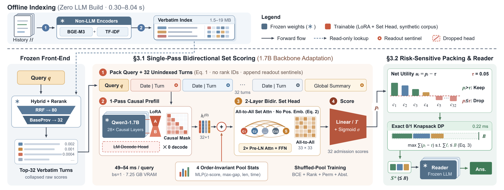

# Vernier: Compare Before You Pack

**Single-Pass Joint Evidence Selection for Long-Term Conversational Memory**

[](#citation)
[](https://huggingface.co/BertramM/vernier-1.7b)
[](https://huggingface.co/datasets/BertramM/vernier-synth-537)
[](LICENSE)

> **TL;DR:** Instead of compressing histories offline with LLMs or packing fixed top-$k$ verbatim turns, **Vernier** runs a single zero-decode forward pass of a 1.7B language model plus a 2-layer position-free bidirectional set head over frozen Top-32 candidates (~50 ms, 7.25 GB VRAM), then packs the highest-value subset via exact knapsack dynamic programming (~0.2 ms CPU) under one fixed threshold $\tau = 0.05$.

<p align="center">
  
</p>

---

## Key Results

Across **5 frozen readers** (`Qwen3-8B`, `Qwen3-14B`, `Mistral-Nemo-12B`, `Qwen3.5-27B`, `GPT-4o-mini`) and **4 benchmarks** up to **1.5M tokens**, Vernier advances the accuracy–context Pareto frontier with **zero offline LLM build tokens**:

| Method | Build LLM Tok | LME-S (110k) 3-Avg | LME-S Tok | LME-M (1.5M) 27B / 4o-m | LME-M Tok | LoCoMo 3-Avg | LoCoMo Tok |
|---|---:|---:|---:|---:|---:|---:|---:|
| HippoRAG 2 (ICML'25) | 30.1M | 73.0 | 1.7k | -- | -- | 67.6 | 0.9k |
| LightMem (ICLR'26) | 32.3M | 66.7 | 0.8k | -- | -- | 70.9 | 0.8k |
| Rerank-TopK (Zero-Build) | 0 | 78.1 | 1.5k | 76.8 / 75.0 | 1.5k | 73.9 | 1.3k |
| **Vernier (Ours)** | **0** | **80.7** | **0.6k** | **79.4 / 78.0** | **0.7k** | **74.5** | **0.7k** |

- **Pooled 5-reader gains over Rerank-TopK:** **+2.48 pp** on `LongMemEval-S` (Holm $p=0.014$) and **+2.76 pp** on `LongMemEval-M` (Holm $p=0.006$) with **50%–57% fewer prompt tokens** and matched end-to-end latency on `LongMemEval-S` (`1.55 s`).
- **Automatic budget adaptation ($\tau=0.05$):** shrinks abstention prompts to `359` tokens while automatically expanding `2.6x` to `943` tokens on dense OOD `UtilMem` (`4.76` gold sessions/query).

---

## Released Artifacts

1. **Code (this repository, Apache-2.0):**
   - `vernier/modeling.py` — `VernierSelector` (`Qwen3-1.7B` rank-32 LoRA + 4-dim pool stats MLP + 2-layer position-free Pre-LN bidirectional set head + learned temperature $T$).
   - `vernier/losses.py` — 4-term training objective ($\mathcal{L}_{\text{BCE}} + 0.55\mathcal{L}_{\text{rank}} + 0.50\mathcal{L}_{\text{perm}} + 0.10\mathcal{L}_{\text{prem}}$).
   - `vernier/packing.py` — exact knapsack dynamic programming (`knapsack_pack`, Algorithm 1) and chronological calendar session rendering.
   - `vernier/frontend.py` — frozen `BGE-M3` + TF-IDF RRF ($k=60$) + `BaseProvence` Top-32 front-end.
   - `vernier/prompts.py` — verbatim symmetric selector, reader, and judge prompts (Boxes E1–E3).
2. **Pretrained Weights (Apache-2.0):** `vernier-1.7b` (`s42` primary + `s43`/`s44` multi-seed LoRA adapters & bidirectional set head, ~394 MB per seed) on HuggingFace ([`BertramM/vernier-1.7b`](https://huggingface.co/BertramM/vernier-1.7b)).
3. **Capability-Driven Synthetic Corpus (Apache-2.0, zero real user PII):** 537 zero-overlap multi-session dialogues across six everyday domains (459 train / 78 val; 4,622 train / 766 val queries) on HuggingFace ([`BertramM/vernier-synth-537`](https://huggingface.co/datasets/BertramM/vernier-synth-537)).

> **License Compliance Note:** Public evaluation benchmarks (`LongMemEval`, `LoCoMo-1986`, `UtilMem`) are **not** redistributed here—please obtain them from their official repositories. In accordance with the `CC-BY-NC-ND-4.0` license of `naver/provence-reranker-debertav3-v1`, no derivative `Set-Encoder`-style weights are distributed.

---

## Installation

```bash
git clone https://github.com/Beichen-Hg/Vernier.git
cd Vernier
pip install -r requirements.txt
```

---

## Quickstart

### 1. Run Single-Pass Selection Demo

Download the `s42` checkpoint (`lora_adapter/` + `head.pt`) into `checkpoints/vernier_s42/` and run:

```bash
python scripts/demo.py \
  --checkpoint checkpoints/vernier_s42 \
  --base-model Qwen/Qwen3-1.7B \
  --budget 1000 \
  --tau 0.05
```

### 2. Python API

```python
import torch
from transformers import AutoTokenizer
from vernier import (
    VernierSelector,
    build_selector_input,
    collate_selector_batch,
    knapsack_pack,
    render_evidence_packet,
)

tok = AutoTokenizer.from_pretrained("Qwen/Qwen3-1.7B")
model = VernierSelector.from_pretrained("checkpoints/vernier_s42", base_model_name_or_path="Qwen/Qwen3-1.7B")

ex = build_selector_input(tok, record, max_cand_tokens=72)
batch = collate_selector_batch([ex], pad_id=tok.pad_token_id, device="cuda")

with torch.inference_mode():
    probs = model(
        batch["input_ids"], batch["attention_mask"], batch["cand_pos"],
        batch["suff_pos"], batch["cand_feats"], batch["cand_mask"],
    )["probs"][0, : len(record["top32"])].float().cpu().numpy()

selected_idx = knapsack_pack(probs, [c["tok_len"] for c in record["top32"]], budget=1000, tau=0.05, k_min=2)
packet = render_evidence_packet([record["top32"][i] for i in selected_idx], question_date=record["question_date"])
```

### 3. Training & Evaluation

```bash
# Train Vernier (single H800 ~47 min/seed, Table A1 defaults)
python scripts/train.py \
  --pools-pkl data/pools_synth.pkl \
  --output-dir checkpoints/vernier_s42 \
  --seed 42

# Evaluate calibration, Turn All-Gold EM, and reverse-order stability
python scripts/evaluate.py \
  --checkpoint checkpoints/vernier_s42 \
  --pools-pkl data/pools_longmemeval_s.pkl \
  --budget 1000 \
  --tau 0.05

# Optional: synthesize additional capability-driven dialogues
export DEEPSEEK_API_KEY="your-api-key"
python scripts/generate_synth.py --num-histories 10 --output data/synth_chapters.jsonl
```

---

## Citation

```bibtex
@article{huang2026vernier,
  title   = {Compare Before You Pack: Single-Pass Joint Evidence Selection for Long-Term Conversational Memory},
  author  = {Huang, Beichen},
  journal = {arXiv preprint},
  year    = {2026}
}
```
